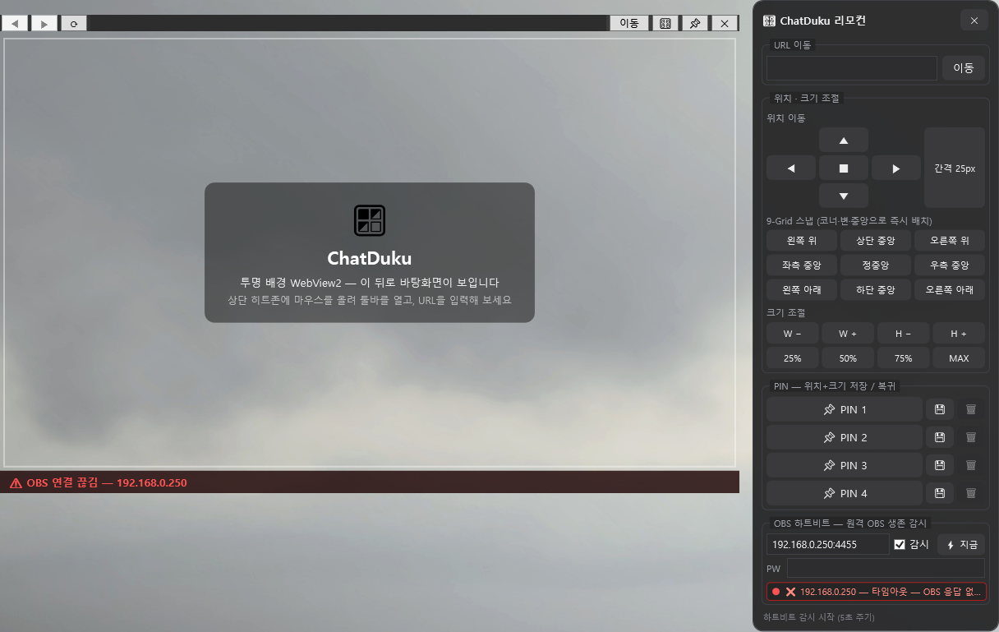

# 🪟 ChatDuku

> 투명 배경 WebView2 브라우저 — 창 너머 바탕화면이 보이는 실험적 웹 뷰어 + 원격 창 컨트롤 리모컨 + OBS 하트비트 감시

[](https://dotnet.microsoft.com/)
[](https://learn.microsoft.com/dotnet/desktop/wpf/)
[](https://developer.microsoft.com/microsoft-edge/webview2/)
[](https://github.com/)
[](LICENSE)

---

> [!IMPORTANT]
> ## 💜 이 프로젝트는 **홍덕쿠** 님의 아이디어로 시작되었습니다!
>
> **[🟢 치지직 채널: https://chzzk.naver.com/c1a2b336568bf8e8b9d1e0fab3f8b8b2](https://chzzk.naver.com/c1a2b336568bf8e8b9d1e0fab3f8b8b2)**
>
> **치지직(CHZZK, 네이버 라이브 스트리밍 플랫폼) 스트리머 홍덕쿠 님의 의견(아이디어)에서 영감을 받아 만든 프로젝트입니다.**
> **시간 되실 때 방송 한번 찾아가서 인사 남겨주세요!! 🙏🙇**

---

## 📸 미리보기

**초기 상태** — 투명 창 + 외곽 사각형 + 안내 카드:


**리모컨 창** — 툴바 노출 후 🎛️ 클릭 (URL 이동 · 위치·크기 · PIN · OBS 하트비트 그룹):


**OBS 연결 끊김 감지** — 감시 중 OBS가 죽으면 채팅창 하단에 빨간 경고 배너:



*배경이 투명하여 창 너머 바탕화면이 그대로 보입니다.*

---

## 📖 설명

**ChatDuku**는 WPF + WebView2 기반의 데스크톱 브라우저입니다. 핵심 컨셉은 **"투명함"**입니다.

1. 창을 `WindowStyle=None` + `AllowsTransparency=True`로 만들고
2. WebView2의 `DefaultBackgroundColor`를 Transparent로 설정한 뒤
3. 페이지 로드 시 JavaScript를 주입해 `body`/`html` 및 내부 요소의 배경색·배경 이미지를 제거하면

→ **웹 페이지 내용 뒤로 바탕화면이 그대로 보입니다.**

방해 없는 위젯형 browsing, 바탕화면 wallpaper 위에 웹 위젯을 얹어 쓰는 용도 등으로 활용할 수 있습니다.

부수적으로 두 가지 강력한 기능을 제공합니다:

- **리모컨 창** — 메인 창의 위치·크기를 원격으로 조절하고, 9-Grid 스냅/간격 이동/PIN(위치+크기 즐겨찾기)으로 원하는 레이아웃을 한 번에 복귀
- **OBS 하트비트** — 같은 네트워크(또는 접근 가능한) 다른 PC들의 OBS Studio가 살아있는지 WebSocket으로 주기 감시, 죽으면 채팅창 하단에 **빨간 경고 배너** 표시

## ✨ 기능

### 메인 창
- 🫥 **투명 배경 렌더링** — 페이지 배경색/배경 이미지를 JS로 제거하여 창 너머가 보이게 함 (늦게 로드되는 CSS 대비 2회 주입)
- 🕶️ **URL 마스킹** — 주소창에 포커스가 없으면 `https://` 이후를 `●`로 가려 표시 (개인정보 보호 데모)
- 👻 **히트존 기반 자동 숨김 툴바** — 상단 14px 히트존에 마우스를 올리면 툴바 페이드 표시, 벗어나면 자동 숨김
- 📐 **경계 없는 창 리사이즈** — `WM_NCHITTEST` 후킹으로 border 없는 창의 8방향 리사이즈 지원
- 📌 **항상 위에(Topmost) 토글**

### 리모컨 창 (`🎛️`)
- 🔗 **URL 이동** — 리모컨에서 바로 대상 창 내비게이션
- 🕹️ **위치 이동** — 방향키 이동 (간격 10 → 25 → 50 → 100px 클릭 순환)
- 🧲 **9-Grid 스냅** — 4코너 · 4변 · 정중앙 즉시 배치
- 📏 **크기 조절** — 너비/높이 단계 조절, 중심 유지 확대/축소, 25% / 50% / 75% / MAX 프리셋
- 📌 **PIN 4개 슬롯** — 현재 위치+크기를 저장, 클릭 한 번으로 복귀 (`pins.json` 영속화)
- 💓 **OBS 하트비트** — 원격 OBS Studio 생존 감시 (아래 섹션 참고)
- ⌨️ 키보드 단축키: 방향키=이동 · `Shift`+방향키=크기 · `+`/`-`=확대/축소 · `C`=중앙 · `Esc`=닫기

### 💓 OBS 하트비트 — 원격 OBS 생존 감시 (v1.0.1 신규)

송출용 PC 여러 대의 OBS Studio가 살아있는지 **obs-websocket**(기본 포트 `4455`)으로 주기적으로 확인합니다.

- **살아있음** 🟢 → 리모컨 상태 행에 초록 점 + OBS Studio/obs-websocket 버전 표시
- **죽었음** 🔴 → 채팅창 **하단에 빨간 경고 배너** (`⚠ OBS 연결 끊김 — 192.168.0.11:4455`) + 리모컨 상태 행 빨간 표시/테두리
- 재접속 자동 시도 — OBS가 다시 켜지면 배너 자동 소거
- 연결 거부/타임아웃/인증 실패 등 사유를 사람이 읽는 문구로 표시 (예: "거부됨 — OBS WebSocket 꺼짐 확인")

#### 버전별 프로토콜 자동 인식

OBS 버전에 따라 obs-websocket 프로토콜이 완전히 다르지만, **설정 없이 자동 탐지**합니다:

| 서버 | 악수 방식 | 자동 인식 방법 |
|---|---|---|
| obs-websocket **5.x** (OBS 28+) — 공식 | 클라이언트 `Hello(op:0)` → 서버 `ServerHello(op:1)` → `Identify(2)/Identified(3)` → 요청 `5`/응답 `6` | 기본값 |
| obs-websocket **5.x 변형** (OBS 32.x 실측) | 서버가 연결 즉시 `ServerHello`를 push — op 맵 전체가 **-1 오프셋**(Identify=1, Identified=2, 요청=4/응답=5), 인증은 `{challenge, salt}` 객체 | 첫 수신이 `op:0` push면 해당 맵으로 자동 캘리브레이션 |
| obs-websocket **4.x** (OBS 27-) | 핸드셰이크 없음, `requestType/messageType` 순수 JSON + `Authenticate` | push/Hello에 무응답이면 v4 세트로 폴백 |

비밀번호도 서버마다 다른 공식을 순차 시도해 맞으면 고정합니다 (공식 `secret+salt`, 챌린지 바인딩 2종, 평문). IP별로 다른 비밀번호를 지정할 수도 있습니다.

#### 사용 방법 — 원격 PC에서 (딱 한 번)

1. **OBS Studio 실행** → 메뉴 **`도구(Tools)` → `WebSocket 서버 설정(WebSocket Server Settings)`**
   - OBS 28+ 에 내장 (27 이하: OBS 설치 시 obs-websocket 플러그인 포함 선택)
2. **`WebSocket 서버 활성화(Enable WebSocket Server)`** 체크 — `시작 시 서버 활성화`도 켜두면 재부팅 후 유지
3. **포트 확인/복사** — 기본 `4455`
4. **`인증(Authentication)`** 섹션:
   - 켜두면(권장) **서버 비밀번호** 칸의 값(또는 `생성/Create` 버튼으로 새 값)을 **복사**
   - 꺼두면 비밀번호 없이 사용 가능
5. **IP 확인/복사** — 원격 PC에서 `Win`+`R` → `cmd` 입력 → `ipconfig` → `IPv4 주소`(예: `192.168.0.11`)를 **복사**
   - 공유기 DHCP 예약으로 고정 IP로 만들어 두면 재부팅 후에도 주소가 안 바뀌어 안전합니다
6. **Windows 방화벽** — 활성화 직후 허용창이 뜨면 `개인 네트워크(Private)` 허용 클릭
   - 전에 차단했다면 `제어판 → Windows Defender 방화벽 → 앱 허용`에서 `obs64` 허용 다시 체크

#### 사용 방법 — 이 PC(리모컨)에서

1. 🎛️ 리모컨 열기 → **OBS 하트비트** 그룹
2. IP 입력창에 원격 PC 주소를 쉼표로 입력 — **복사해둔 IP와 비밀번호를 그대로 붙여넣기**:
   ```
   192.168.0.11=pw1, 192.168.0.12:4455=pw2, 192.168.0.13
   ```
   - `IP=비밀번호`: 그 PC 전용 비밀번호 (OBS WebSocket 설정에서 복사한 값)
   - 비밀번호 없는 항목은 아래 **PW** 칸의 기본 비밀번호 사용
   - 포트 생략 시 `4455`
3. **`감시` 체크박스** 체크 (또는 Enter) → 각 OBS가 🟢으로 바뀌고 버전 표시
4. 송출 중 OBS가 꺼지거나 네트워크가 끊기면 ~15–25초 후 하단 빨간 배너 표시, 살아나면 자동 소거
5. **`⚡ 지금`** — 주기 대기 없이 즉시 재확인

> 설정(`감시 ON/IP/PW`)은 `appsettings.json`에 저장되어 앱 재시작 시 자동 복원됩니다.

### 🧺 통합 채팅 URL로 위젯처럼 쓰기

투명 창 + 리모컨 + PIN을 조합하면 **방송 채팅창을 바탕화면 위 여러 곳에 붙여두고** 쓸 수 있습니다. 아래 URL들을 URL 이동(메인 툴바 또는 리모컨)에 입력하고, 위치/크기를 PIN 슬롯에 저장해 두면 레이아웃이 언제든 원복됩니다.

| 서비스 | 채팅/위젯 URL | 메모 |
|---|---|---|
| **치지직 CHZZK** | `https://chzzk.naver.com/<채널ID>` | 채널 페이지의 채팅 영역이 그대로 보입니다. 채팅만 크게 쓰고 싶으면 창을 우측 좁게 리사이즈 + 9-Grid `우측 중앙` |
| **SOOP(구 아프리카TV)** | `https://play.sooplive.co.kr/<USER_ID>` | 재생+채팅 통합 페이지 |
| **트위치** | `https://www.twitch.tv/popout/<채널>/chat?darkpopout` | 공식 **채팅 팝아웃** — 어두운 채팅방만 창처럼 열림 (투명 위젯과 궁합 좋음) |
| **유튜브** | `https://www.youtube.com/live_chat?v=<영상ID>` | 공식 **Live Chat 팝아웃** (`embed_domain=` 파라미터 생략 가능) |
| **알림 위젯 (Streamlabs 등)** | Streamlabs 대시보드 → 위젯 → Chat Box/Alerts → `위젯 URL 복사` 후 입력 | 채팅/후원 알림을 한 번에 — 각 서비스의 "Overlay URL"을 그대로 사용 |
| **여러 서비스 통합** | 서비스별 팝아웃 URL을 **메인 창 하나 + 리모컨 PIN 슬롯**에 나눠 저장 | PIN 클릭으로 채팅방 레이아웃 즉시 전환. OBS 화면capture로 "화면.crtwin" 창 캡처 시 채팅 위젯 소스로도 재활용 가능 |

> 💡 투명도 때문에 URL 마스킹(●●●)이 기본입니다 — 입력창 클릭 시 실제 URL이 보입니다.

## 🏗️ 아키텍처

하드코딩을 `AppSettings`에 모으고, 각 기능을 독립적인 클래스로 분리했습니다.
창 코드비하인드는 **조합(wiring)과 표시**만 담당하고, 로직은 서비스 클래스에 위임합니다.

```
ChatDuku/
├── App.xaml(.cs)                  # 진입점 — AppSettings.Load() 후 메인 창 실행
├── MainWindow.xaml(.cs)           # 메인 창 — 서비스 조합/와이어링 + 하트비트 배너 표시
├── RemoteControlWindow.xaml(.cs)  # 리모컨 창 — 버튼 이벤트/상태 표시 + 하트비트 상태 행
│
├── Configuration/
│   └── AppSettings.cs             # 전체 설정의 단일 출처, appsettings.json 오버라이드
│
├── Browser/                       # 브라우저 기능 (UI 무관 단위 재사용 가능)
│   ├── WebView2Session.cs       #   WebView2 초기화/내비게이션/배경 투명화
│   ├── UrlHelper.cs             #   URL 정규화·마스킹 순수 로직
│   ├── UrlInputBox.cs           #   URL 입력 마스킹/포커스/Enter 캡슐화
│   └── TransparentPageScripts.cs #  주입 JS·데모 HTML
│
├── UI/                          # 범용 WPF 헬퍼
│   ├── AutoHideToolbar.cs       #   툴바 자동 숨김/페이드 애니메이션
│   └── WindowResizeHelper.cs    #   WM_NCHITTEST 리사이즈·컨트롤 제외 드래그
│
└── Remote/                      # 리모컨 기능
    ├── WindowController.cs      #   창 위치/크기 제어 로직 (리모컨의 두뇌)
    ├── PinSlot.cs               #   PIN 데이터 레코드
    ├── PinRepository.cs         #   PIN JSON 영속화
    ├── RemoteWindowPlacer.cs    #   beside 배치 계산
    └── ObsHeartbeatMonitor.cs   #   🔑 OBS 하트비트 — v5/5.x변형/v4 프로토콜 자동
                                   #      캘리브레이션 + 인증 후보 로테이션 + 자동재접속
```

## 📷 스크린샷 다시 만들기 (선택)

앱에 내장된 데모 시나리오 모드(일반 실행에는 영향 없음)를 이용하면 동일한 구도의 이미지를 얻을 수 있습니다:

```
set CHATDUKU_SHOT=1
dotnet run
```

- t≈5초에 툴바가, t≈8초에 리모컨 창이 자동으로 열린 뒤 고정 유지됩니다
- 이때 `Win`+`Shift`+`S`로 영역 캡처하면 `docs/`의 미리보기와 같은 이미지를 만들 수 있습니다

`tools/take-screenshots.ps1`을 실행하면 ① 초기 ② 리모컨 ③ OBS 연결 끊김(더미 IP 감시 → 빨간 배너) 세 장을 자동으로 캡처합니다 (캡처 중 바탕화면 아이콘은 자동으로 숨김/복원).

## 🚀 빌드 & 실행

### 요구 사항
- Windows 10/11
- [.NET 10 SDK](https://dotnet.microsoft.com/download/dotnet)
- [Microsoft Edge WebView2 Runtime](https://developer.microsoft.com/microsoft-edge/webview2/) (Windows 11/최신 Win10엔 기본 포함)

### 빌드
```
git clone https://github.com/<your-id>/ChatDuku.git
cd ChatDuku
dotnet build
dotnet run
```

### Release 빌드 / self-contained publish (런타임 미설치 PC용)

```
dotnet build ChatDuku/ChatDuku.csproj -c Release
dotnet publish ChatDuku/ChatDuku.csproj -c Release -r win-x64 --self-contained true -o publish\chatduku-win-x64
```

- .NET 런타임이 없는 PC에서도 `ChatDuku.exe` 더블클릭으로 실행됩니다
- `publish/chatduku-win-x64/` 폴더째 복사하거나 zip(예: `chatduku-v1.0.1-win-x64-selfcontained.zip`)으로 배포
- GitHub Releases에서 바이너리 배포판 다운로드 가능

## ⚙️ 설정 (appsettings.json)

모든 값은 [`Configuration/AppSettings.cs`](Configuration/AppSettings.cs)의 기본값을 따릅니다.
실행 폴더(`bin/Debug/net10.0-windows/`)에 `appsettings.json`을 두면 개별 키만 골라 덮어쓸 수 있습니다.

```json
{
  "AppDisplayName": "ChatDuku",
  "MainWindowWidth": 900,
  "MainWindowHeight": 600,
  "SearchUrlFormat": "https://www.bing.com/search?q={0}",
  "ToolbarHideDelayMs": 1500,
  "ResizeBorderThickness": 8,
  "WindowFrameColor": "#88FFFFFF",
  "WindowFrameThickness": 2,
  "PinSlotCount": 4,
  "MoveStepCycle": [10, 25, 50, 100],
  "SizeFractions": [0.25, 0.5, 0.75, 0.95],

  "HeartbeatEnabled": false,
  "HeartbeatHosts": "192.168.0.11=pw1, 192.168.0.12",
  "HeartbeatPassword": "공통비밀번호",
  "ObsWebSocketPort": 4455,
  "ObsHeartbeatIntervalMs": 5000,
  "ObsConnectTimeoutMs": 3000,
  "ObsResponseTimeoutMs": 5000,
  "ObsDeadThreshold": 3
}
```

> 손상된 설정 파일은 예외 없이 무시되고 기본값으로 동작합니다.
> `HeartbeatPassword`는 화이트리스트 리모컨에 노출되니 공유 PC에선 파일 접근을 통제하세요.

## 🧾 변경 로그

### v1.0.1
- 💓 **OBS 하트비트 감시 추가** — 원격 PC들의 OBS Studio(obs-websocket) 생존 확인, 사망 시 채팅창 하단 빨간 경고 배너
  - obs-websocket 5.x(공식) / 5.x 서버선행 변형(OBS 32.x, `{challenge,salt}` 인증) / 4.x — **프로토콜 자동 캘리브레이션**
  - IP별 비밀번호 지정 (`IP=PW`), 공통 PW, 인증 공식 자동 로테이션, 자동 재접속, 설정 영속화
- 🎛️ 리모컨 레이아웃 GroupBox 그룹핑 (URL → 위치·크기 → PIN → OBS 하트비트)
- 🩹 우아한 오류 문구화 (타임아웃/거부/인증 실패 등)

### v1.0.0
- 투명 배경 WebView2 브라우저 + 자동 숨김 툴바
- 리모컨 창 (이동/스냅/크기/PIN)
- self-contained win-x64 바이너리 배포

## 🤝 기여

1. `main`에서 브랜치를 따세요: `git checkout -b feature/awesome`
2. 변경 후 `dotnet build`로 빌드를 확인하세요 (경고 0·오류 0 유지)
3. 커밋 후 PR을 올려주세요

## 📄 라이선스

이 프로젝트는 **[MIT License](LICENSE)** 하에 배포됩니다.
재배포·개작 시 [`LICENSE`](LICENSE) 파일의 **저작권 및 라이선스 고지문을 포함**해야 하며,
프로젝트 코드를 참조·복제한 경우 출처 표기를 권장합니다.

```
Copyright (c) 2026 ChatDuku contributors
SPDX-License-Identifier: MIT
```

### 서드파티 오픈소스 고지

이 프로젝트는 아래 오픈소스를 **참조/사용**하며, 각 프로젝트의 원래 라이선스가 적용됩니다.
재배포 시 원 라이선스 및 저작권 표기를 반드시 포함하세요.

| 라이브러리 | 용도 | 라이선스 |
|---|---|---|
| [.NET / WPF](https://github.com/dotnet/wpf) | 런타임·UI 프레임워크 | [MIT](https://github.com/dotnet/wpf/blob/main/LICENSE.TXT) |
| [Microsoft.Web.WebView2](https://github.com/MicrosoftEdge/WebView2Feedback) (NuGet SDK) | 내장 브라우저 컨트롤 | [MIT](https://www.nuget.org/packages/Microsoft.Web.WebView2) (패키지) / [WebView2 Runtime 사용 약관](https://learn.microsoft.com/microsoft-edge/webview2/terms) |
| [obs-websocket](https://github.com/obsproject/obs-websocket) | 프로토콜 연동 대상 (OBS Studio 내장) | [GPL-2.0](https://github.com/obsproject/obs-websocket/blob/master/LICENSE) |

자세한 내용은 [`LICENSE`](LICENSE) 파일을 참고하세요.
