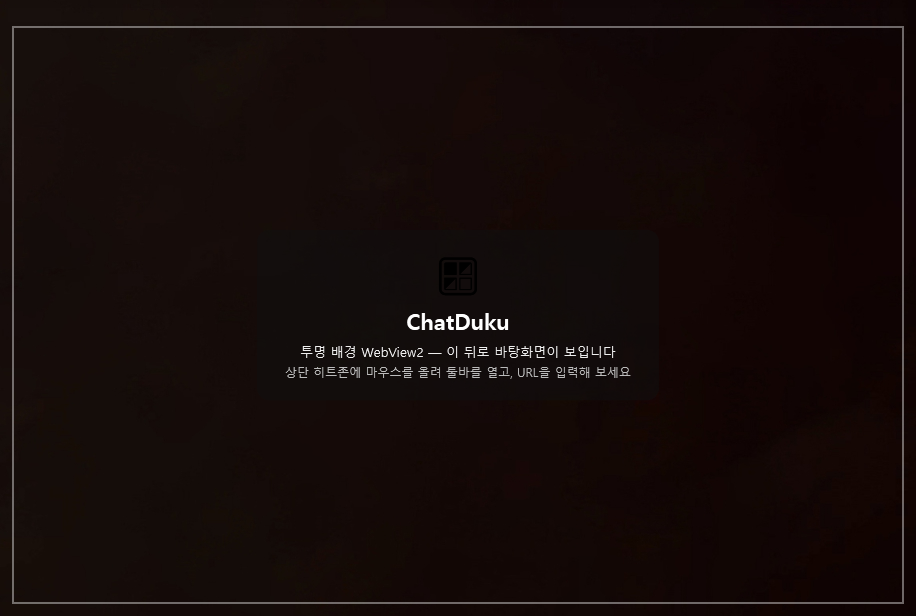
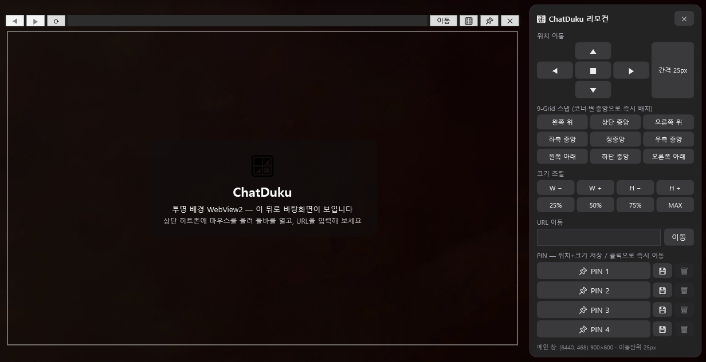

# 🪟 ChatDuku

> 투명 배경 WebView2 브라우저 — 창 너머 바탕화면이 보이는 실험적 웹 뷰어 + 원격 창 컨트롤 리모컨

[](https://dotnet.microsoft.com/)
[](https://learn.microsoft.com/dotnet/desktop/wpf/)
[](https://developer.microsoft.com/microsoft-edge/webview2/)
[](LICENSE)

---

> [!IMPORTANT]
> ## 💜 이 프로젝트는 **홍덕쿠** 님의 아이디어로 시작되었습니다!
>
> **[🔴 https://chzzk.naver.com/c1a2b336568bf8e8b9d1e0fab3f8b8b2](https://chzzk.naver.com/c1a2b336568bf8e8b9d1e0fab3f8b8b2)**
>
> **아프리카TV(CHZZK) 스트리머 홍덕쿠 님의 의견(아이디어)에서 영감을 받아 만든 프로젝트입니다.**
> **시간 되실 때 방송 한번 찾아가서 인사 남겨주세요!! 🙏🙇**

---

## 📸 미리보기

**초기 상태** — 투명 창 + 외곽 사각형 + 안내 카드:



**리모컨 창** — 툴바 노출 후 🎛️ 클릭 (9-Grid 스냅·크기 조절·PIN 슬롯):



*배경이 투명하여 창 너머 바탕화면이 그대로 보입니다.*

---

## 📖 설명

**ChatDuku**는 WPF + WebView2 기반의 데스크톱 브라우저입니다. 핵심 컨셉은 **"투명함"**입니다.

1. 창을 `WindowStyle=None` + `AllowsTransparency=True`로 만들고
2. WebView2의 `DefaultBackgroundColor`를 Transparent로 설정한 뒤
3. 페이지 로드 시 JavaScript를 주입해 `body`/`html` 및 내부 요소의 배경색·배경 이미지를 제거하면

→ **웹 페이지 내용 뒤로 바탕화면이 그대로 보입니다.**

방해 없는 위젯형 browsing, 바탕화면 wallpaper 위에 웹 위젯을 얹어 쓰는 용도 등으로 활용할 수 있습니다.

부수적으로 **리모컨 창**을 제공합니다: 리모컨 창에서 메인 창의 위치·크기를 원격으로 조절하고, 9-Grid 스냅/간격 이동/PIN(위치+크기 즐겨찾기)으로 원하는 레이아웃을 한 번에 복귀할 수 있습니다.

## ✨ 기능

### 메인 창
- 🫥 **투명 배경 렌더링** — 페이지 배경색/배경 이미지를 JS로 제거하여 창 너머가 보이게 함 (늦게 로드되는 CSS 대비 2회 주입)
- 🕶️ **URL 마스킹** — 주소창에 포커스가 없으면 `https://` 이후를 `●`로 가려 표시 (개인정보 보호 데모)
- 👻 **히트존 기반 자동 숨김 툴바** — 상단 14px 히트존에 마우스를 올리면 툴바 페이드 표시, 벗어나면 자동 숨김
- 📐 **경계 없는 창 리사이즈** — `WM_NCHITTEST` 후킹으로 border 없는 창의 8방향 리사이즈 지원
- 📌 **항상 위에(Topmost) 토글**

### 리모컨 창 (`🎛️`)
- 방향키 이동 (간격 10 → 25 → 50 → 100px 클릭 순환)
- 9-Grid 스냅 (4코너 · 4변 · 정중앙 즉시 배치)
- 너비/높이 단계 조절, 중심 유지 확대/축소
- 25% / 50% / 75% / MAX 크기 프리셋
- 원격 URL 이동
- 📌 **PIN 4개 슬롯** — 현재 위치+크기를 저장, 클릭 한 번으로 복귀 (`pins.json` 영속화)
- ⌨️ 키보드 단축키: 방향키=이동 · `Shift`+방향키=크기 · `+`/`-`=확대/축소 · `C`=중앙 · `Esc`=닫기

## 🏗️ 아키텍처

하드코딩을 `AppSettings`에 모으고, 각 기능을 독립적인 클래스로 분리했습니다.
창 코드비하인드는 **조합(wiring)과 표시**만 담당하고, 로직은 서비스 클래스에 위임합니다.

```
ChatDuku/
├── App.xaml(.cs)                  # 진입점 — AppSettings.Load() 후 메인 창 실행
├── MainWindow.xaml(.cs)           # 메인 창 — 서비스 조합/와이어링만 담당
├── RemoteControlWindow.xaml(.cs)  # 리모컨 창 — 버튼 이벤트/상태 표시만 담당
│
├── Configuration/
│   └── AppSettings.cs             # 전체 설정의 단일 출처, appsettings.json 오버라이드
│
├── Browser/                       # 브라우저 기능 (UI 무관 단위 재사용 가능)
│   ├── WebView2Session.cs       #   WebView2 초기화/내비게이션/배경 투명화
│   ├── UrlHelper.cs             #   URL 정규화·마스킹 순수 로직
│   ├── UrlInputBox.cs           #   URL 입력 마스킹/포커스/Enter 캡슐화
│   └── TransparentPageScripts.cs #  주입 JS·데모 HTML
│
├── UI/                          # 범용 WPF 헬퍼
│   ├── AutoHideToolbar.cs       #   툴바 자동 숨김/페이드 애니메이션
│   └── WindowResizeHelper.cs    #   WM_NCHITTEST 리사이즈·컨트롤 제외 드래그
│
└── Remote/                      # 리모컨 기능
    ├── WindowController.cs      #   창 위치/크기 제어 로직 (리모컨의 두뇌)
    ├── PinSlot.cs               #   PIN 데이터 레코드
    ├── PinRepository.cs         #   PIN JSON 영속화
    └── RemoteWindowPlacer.cs    #   beside 배치 계산
```

## 📷 스크린샷 다시 만들기 (선택)

앱에 내장된 데모 시나리오 모드(일반 실행에는 영향 없음)를 이용하면 동일한 구도의 이미지를 얻을 수 있습니다:

```
set CHATDUKU_SHOT=1
dotnet run
```

- t≈5초에 툴바가, t≈8초에 리모컨 창이 자동으로 열린 뒤 고정 유지됩니다
- 이때 `Win`+`Shift`+`S`로 영역 캡처하면 `docs/`의 미리보기와 같은 이미지를 만들 수 있습니다

## 🚀 빌드 & 실행

### 요구 사항
- Windows 10/11
- [.NET 10 SDK](https://dotnet.microsoft.com/download/dotnet)
- [Microsoft Edge WebView2 Runtime](https://developer.microsoft.com/microsoft-edge/webview2/) (Windows 11/최신 Win10엔 기본 포함)

### 빌드
```
git clone https://github.com/<your-id>/ChatDuku.git
cd ChatDuku
dotnet build
dotnet run
```

## ⚙️ 설정 (appsettings.json)

모든 값은 [`Configuration/AppSettings.cs`](Configuration/AppSettings.cs)의 기본값을 따릅니다.
실행 폴더(`bin/Debug/net10.0-windows/`)에 `appsettings.json`을 두면 개별 키만 골라 덮어쓸 수 있습니다.

```json
{
  "AppDisplayName": "ChatDuku",
  "MainWindowWidth": 900,
  "MainWindowHeight": 600,
  "SearchUrlFormat": "https://www.bing.com/search?q={0}",
  "ToolbarHideDelayMs": 1500,
  "ResizeBorderThickness": 8,
  "WindowFrameColor": "#88FFFFFF",
  "WindowFrameThickness": 2,
  "PinSlotCount": 4,
  "MoveStepCycle": [10, 25, 50, 100],
  "SizeFractions": [0.25, 0.5, 0.75, 0.95]
}
```

> 손상된 설정 파일은 예외 없이 무시되고 기본값으로 동작합니다.

## 🤝 기여

1. `main`에서 브랜치를 따세요: `git checkout -b feature/awesome`
2. 변경 후 `dotnet build`로 빌드를 확인하세요 (경고 0·오류 0 유지)
3. 커밋 후 PR을 올려주세요

## 📄 라이선스

이 프로젝트는 **[MIT License](LICENSE)** 하에 배포됩니다.
재배포·개작 시 [`LICENSE`](LICENSE) 파일의 **저작권 및 라이선스 고지문을 포함**해야 하며,
프로젝트 코드를 참조·복제한 경우 출처 표기를 권장합니다.

```
Copyright (c) 2026 ChatDuku contributors
SPDX-License-Identifier: MIT
```

### 서드파티 오픈소스 고지

이 프로젝트는 아래 오픈소스를 **참조/사용**하며, 각 프로젝트의 원래 라이선스가 적용됩니다.
재배포 시 원 라이선스 및 저작권 표기를 반드시 포함하세요.

| 라이브러리 | 용도 | 라이선스 |
|---|---|---|
| [.NET / WPF](https://github.com/dotnet/wpf) | 런타임·UI 프레임워크 | [MIT](https://github.com/dotnet/wpf/blob/main/LICENSE.TXT) |
| [Microsoft.Web.WebView2](https://github.com/MicrosoftEdge/WebView2Feedback) (NuGet SDK) | 내장 브라우저 컨트롤 | [MIT](https://www.nuget.org/packages/Microsoft.Web.WebView2) (패키지) / [WebView2 Runtime 사용 약관](https://learn.microsoft.com/microsoft-edge/webview2/terms) |

자세한 내용은 [`LICENSE`](LICENSE) 파일을 참고하세요.
